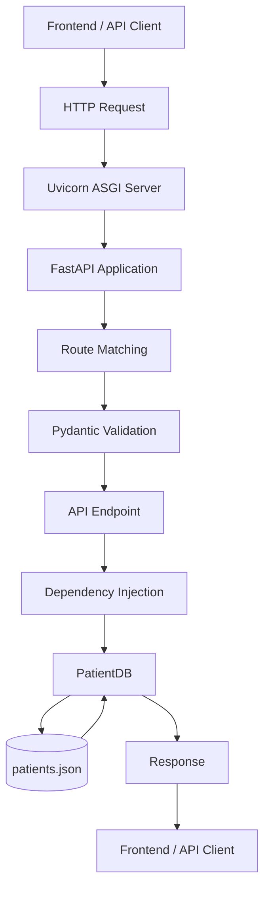

# FastAPI Patient Management API

A beginner-friendly Patient Management API built with **Python and FastAPI** as part of my backend development learning journey.

This project demonstrates how to build REST APIs, handle HTTP requests, validate data using Pydantic, manage dependencies, and perform CRUD operations.

It also serves as a learning resource for understanding FastAPI concepts and preparing for Python backend developer interviews.

---

## Table of Contents

1. [Project Overview](#project-overview)
2. [Features](#features)
3. [Tech Stack](#tech-stack)
4. [Project Structure](#project-structure)
5. [Application Architecture](#application-architecture)
6. [Installation and Setup](#installation-and-setup)
7. [Running the Application](#running-the-application)
8. [API Documentation](#api-documentation)
9. [API Endpoints](#api-endpoints)
10. [Understanding FastAPI](#understanding-fastapi)
11. [Core FastAPI Concepts](#core-fastapi-concepts)
12. [HTTP and REST API Concepts](#http-and-rest-api-concepts)
13. [FastAPI Interview Questions](#fastapi-interview-questions)
14. [Practical Code Examples](#practical-code-examples)
15. [Best Practices](#best-practices)
16. [Learning Roadmap](#learning-roadmap)
17. [Useful Resources](#useful-resources)

---

# 1. Project Overview

The Patient Management API is a simple backend application developed using FastAPI.

It allows users to manage patient records through HTTP endpoints.

The project helped me understand how FastAPI works in practice, how API requests are processed, and how Pydantic validates incoming data.

### What I Practiced

- Building REST API endpoints.
- Implementing Create, Read, and Delete operations.
- Handling HTTP requests and responses.
- Working with path and query parameters.
- Data validation using Pydantic.
- Dependency Injection using `Depends`.
- Application lifecycle management.
- Exception handling.
- JSON-based data storage.

**Note:** The current implementation uses JSON file storage. An Update endpoint, SQL database, authentication, and automated tests are not yet implemented.

---

# 2. Features

- Create new patient records.
- Retrieve all patient records.
- Retrieve individual patient records.
- Delete patient records.
- Filter patients by city.
- Sort patients by age, weight, and BMI.
- Validate incoming data using Pydantic.
- Validate email addresses.
- Calculate BMI automatically.
- Handle errors using HTTP exceptions.
- Automatically generated API documentation.

---

# 3. Tech Stack

| Technology | Purpose |
|---|---|
| Python | Programming language |
| FastAPI | Backend web framework |
| Pydantic | Data validation and modelling |
| Uvicorn | ASGI server |
| JSON | Data storage |
| uv | Python dependency and project management |

### Understanding the Technologies

**FastAPI:** Handles HTTP requests, API routes, request validation integration, and responses.

**Pydantic:** Validates and structures incoming and outgoing data.

**Uvicorn:** Runs the FastAPI application as an ASGI server.

**JSON:** Stores patient records in a local file.

---

# 4. Project Structure

```text
fastapi-learning/
│
├── main.py
├── models.py
├── database.py
├── patients.json
├── pyproject.toml
├── uv.lock
├── .python-version
├── .gitignore
└── README.md
```

### File Responsibilities

| File | Responsibility |
|---|---|
| main.py | FastAPI application and API endpoints |
| models.py | Pydantic models and validation |
| database.py | Patient data operations |
| patients.json | Stores patient records |
| pyproject.toml | Project configuration and dependencies |
| uv.lock | Locked dependency versions |
| README.md | Project documentation |

---

# 5. Application Architecture

Understanding how an API request travels through an application is important for backend development.

### Request-Response Flow



### How It Works

1. A client sends an HTTP request.
2. Uvicorn receives the request.
3. FastAPI identifies the requested endpoint.
4. Incoming data is validated using Pydantic when applicable.
5. FastAPI resolves required dependencies.
6. The endpoint executes the application logic.
7. PatientDB performs the required data operation.
8. Data is stored or retrieved from the JSON file.
9. FastAPI returns an HTTP response.

---

# 6. Installation and Setup

### Prerequisites

- Python 3.11 or newer.
- Git.
- uv package manager (recommended).

### Step 1: Clone the Repository

```bash
git clone https://github.com/gullsnobar/fastapi-learning.git

cd fastapi-learning
```

### Step 2: Install Dependencies

Using uv:

```bash
uv sync
```

This installs the project dependencies using the configuration and lockfile.

### Alternative: Using pip

Create a virtual environment.

**Windows:**

```bash
python -m venv .venv

.venv\Scripts\activate
```

**Linux/macOS:**

```bash
python3 -m venv .venv

source .venv/bin/activate
```

Install dependencies:

```bash
pip install "fastapi[standard]" "email-validator"
```

---

# 7. Running the Application

Start the development server:

```bash
uv run fastapi dev main.py
```

If using pip:

```bash
fastapi dev main.py
```

The application will normally be available at:

```text
http://127.0.0.1:8000
```

### Interactive API Documentation

FastAPI automatically generates API documentation.

**Swagger UI:**

```text
http://127.0.0.1:8000/docs
```

**ReDoc:**

```text
http://127.0.0.1:8000/redoc
```

**OpenAPI JSON:**

```text
http://127.0.0.1:8000/openapi.json
```

---

# 8. API Documentation

The application exposes different endpoints to manage patient records.

### Base URL

```text
http://127.0.0.1:8000
```

### Available Endpoints

| HTTP Method | Endpoint | Description |
|---|---|---|
| GET | `/` | Welcome message |
| GET | `/about` | Application information |
| GET | `/view` | Retrieve all patients |
| GET | `/patient/{patient_id}` | Retrieve one patient |
| POST | `/create` | Create a patient |
| DELETE | `/delete/{patient_id}` | Delete a patient |

### Create Patient

**Method:** POST

**Endpoint:**

```text
/create
```

Example request body:

```json
{
  "name": "Alex Morgan",
  "email": "alex.morgan@example.com",
  "age": 32,
  "gender": "Male",
  "weight": 72.5,
  "height": 1.78,
  "married": false,
  "allergies": ["Peanuts"],
  "address": {
    "city": "Lahore",
    "state": "Punjab",
    "pin_code": "54000"
  }
}
```

The application validates the incoming data before processing it.

### Retrieve All Patients

**Method:** GET

```text
/view
```

Optional query parameters:

```text
/view?city=Lahore
```

```text
/view?sort_by=age&order=desc
```

Available sorting fields:

- age
- weight
- bmi

### Retrieve a Single Patient

**Method:** GET

```text
/patient/P001
```

Returns the patient associated with the provided ID.

### Delete Patient

**Method:** DELETE

```text
/delete/P001
```

Deletes the specified patient record.

### CRUD Implementation Status

| Operation | Status |
|---|---|
| Create | Implemented |
| Read | Implemented |
| Update | Not implemented yet |
| Delete | Implemented |

The `PatientUpdate` model exists in the project, but an update endpoint has not yet been connected to it.

---

# 9. Understanding FastAPI

## What is FastAPI?

FastAPI is a modern, high-performance Python web framework used to build APIs.

It helps developers create API endpoints, process HTTP requests, validate incoming data, and return responses.

It is not a database. It is a backend web framework.

## Why Do We Use FastAPI?

There are several reasons developers choose FastAPI.

### 1. High Performance

FastAPI supports asynchronous programming through Python's `async` and `await`.

It can efficiently handle concurrent I/O operations, such as database queries and external API calls, when asynchronous libraries are used.

### 2. Automatic Data Validation

FastAPI integrates with Pydantic.

It validates incoming request data based on Python types and model definitions.

Developers do not need to manually write every validation rule.

### 3. Automatic API Documentation

FastAPI automatically generates API documentation using OpenAPI.

It provides:

- Swagger UI.
- ReDoc.
- OpenAPI JSON schema.

### 4. Dependency Injection

FastAPI provides a built-in dependency injection system.

It helps reuse common functionality such as database connections, authentication, and configuration.

## FastAPI vs Flask vs Django

| Feature | FastAPI | Flask | Django |
|---|---|---|---|
| Type | Web framework | Web framework | Full-stack web framework |
| Performance | High-performance ASGI framework | Lightweight framework | Full-featured framework |
| Async support | Native support | Available with limitations | Supported |
| Data validation | Pydantic integration | Usually additional libraries | Forms and serializers via ecosystem |
| Documentation | Automatic OpenAPI | Usually extensions | Usually additional tools |
| ORM | External libraries | External libraries | Built-in ORM |
| Best suited for | APIs and modern backend services | Lightweight applications | Full-stack applications |

---

# 10. Core FastAPI Concepts

## 1. What Are API Endpoints?

An endpoint is a specific URL and HTTP method through which a client interacts with an application.

Example:

```python
@app.get("/patients")
async def get_patients():
    return {"message": "All patients"}
```

## 2. What Are Path Parameters?

Path parameters are values passed directly inside the URL.

Example:

```python
@app.get("/patient/{patient_id}")
async def get_patient(patient_id: int):
    return {"patient_id": patient_id}
```

Request:

```text
/patient/10
```

The value `10` is passed as the `patient_id`.

## 3. What Are Query Parameters?

Query parameters are additional values passed after the `?` symbol in a URL.

Example:

```python
@app.get("/patients")
async def get_patients(city: str = "Lahore"):
    return {"city": city}
```

Request:

```text
/patients?city=Lahore
```

Common use cases:

- Filtering.
- Searching.
- Sorting.
- Pagination.

## 4. What Is a Request Body?

A request body contains data sent by the client to the API.

It is commonly used with POST, PUT, and PATCH requests.

Example:

```python
from pydantic import BaseModel

class Patient(BaseModel):
    name: str
    age: int
```

The client sends JSON data, and FastAPI validates it using the model.

## 5. What Is Pydantic?

Pydantic is a Python library used for data validation and modelling.

Example:

```python
from pydantic import BaseModel, Field

class User(BaseModel):
    name: str
    age: int = Field(gt=0)
```

Here:

- name must be a string.
- age must be an integer greater than zero.

## 6. What Is Data Validation?

Data validation checks whether incoming data follows the expected structure and rules.

For example:

If an API expects an integer for age but receives an invalid value, validation will fail.

FastAPI and Pydantic help automate this process.

## 7. What Is Dependency Injection?

Dependency Injection is a design pattern where required objects or services are provided to a function rather than created manually inside it.

FastAPI provides `Depends()` for this purpose.

Example:

```python
from fastapi import Depends

def get_database():
    return "Database connection"

@app.get("/users")
async def get_users(db=Depends(get_database)):
    return {"database": db}
```

Benefits:

- Code reusability.
- Better organization.
- Easier testing.
- Separation of concerns.

## 8. What Are Async and Await?

Python supports asynchronous programming through `async` and `await`.

Example:

```python
@app.get("/example")
async def example():
    return {"message": "Hello"}
```

`async def` defines a coroutine function.

`await` pauses the current coroutine while an asynchronous operation completes.

This allows other tasks to run while the application waits for I/O.

## 9. What Is ASGI?

ASGI stands for Asynchronous Server Gateway Interface.

It is a standard interface between asynchronous Python web servers and applications.

FastAPI is built for the ASGI ecosystem.

## 10. What Is Uvicorn?

Uvicorn is an ASGI server.

It runs applications such as FastAPI and handles incoming network connections.

FastAPI and Uvicorn are different things:

- FastAPI: Defines the API application.
- Uvicorn: Runs the application.

## 11. What Is Middleware?

Middleware is code that runs around the request-response lifecycle.

It can process requests before they reach an endpoint and responses before they are returned.

Common use cases:

- Request logging.
- CORS.
- Request timing.
- Security headers.

## 12. What Is Exception Handling?

Exception handling manages errors that occur during application execution.

Example:

```python
from fastapi import HTTPException

raise HTTPException(
    status_code=404,
    detail="Patient not found"
)
```

This returns a proper HTTP error response.

## 13. What Is OpenAPI?

OpenAPI is a standard specification used to describe HTTP APIs.

FastAPI automatically generates an OpenAPI schema based on the application.

## 14. What Are Swagger UI and ReDoc?

Both are tools for viewing and exploring API documentation.

Swagger UI allows developers to interact with API endpoints directly from the browser.

ReDoc provides another structured API documentation interface.

## 15. What Is CORS?

CORS stands for Cross-Origin Resource Sharing.

It controls whether a browser allows a frontend application from one origin to access resources from another origin.

FastAPI supports CORS through `CORSMiddleware`.

## 16. What Is a Response Model?

A response model defines the structure of the data returned by an endpoint.

Example:

```python
@app.get("/users", response_model=list[User])
async def get_users():
    return users
```

It helps validate, document, and filter API responses.

---

# 11. HTTP and REST API Concepts

## What Is HTTP?

HTTP stands for Hypertext Transfer Protocol.

It is a communication protocol used between clients and servers.

APIs commonly use HTTP to exchange requests and responses.

## HTTP Methods

| Method | Purpose |
|---|---|
| GET | Retrieve data |
| POST | Create data or trigger an operation |
| PUT | Replace an existing resource |
| PATCH | Partially update a resource |
| DELETE | Remove a resource |

## HTTP Status Codes

| Status Code | Meaning |
|---|---|
| 200 | OK |
| 201 | Created |
| 204 | No Content |
| 400 | Bad Request |
| 401 | Unauthorized |
| 403 | Forbidden |
| 404 | Not Found |
| 409 | Conflict |
| 422 | Unprocessable Content |
| 500 | Internal Server Error |

## What Is a REST API?

REST stands for Representational State Transfer.

It is an architectural style for designing network-based applications.

Common REST principles include:

- Client-server architecture.
- Stateless communication.
- Resource-based URLs.
- Consistent use of HTTP methods.
- Appropriate HTTP status codes.

Example:

```text
GET    /patients
POST   /patients
GET    /patients/10
PUT    /patients/10
PATCH  /patients/10
DELETE /patients/10
```

## What Is Idempotency?

An operation is idempotent when repeating the same request produces the same intended effect as performing it once.

GET, PUT, and DELETE are defined as idempotent HTTP methods.

POST is generally not idempotent.

---

# 12. FastAPI Interview Questions

Use this section to revise important FastAPI concepts before technical interviews.

Try answering each question yourself before reading its answer.

## Beginner-Level Questions

### 1. What is FastAPI?

FastAPI is a modern Python web framework used to build APIs. It provides request handling, data validation, dependency injection, and automatic API documentation.

### 2. Why is FastAPI popular?

Because of its performance, Pydantic integration, automatic documentation, Python type hints, and asynchronous programming support.

### 3. Is FastAPI a database?

No. FastAPI is a web framework. It communicates with databases through database drivers, ORMs, or other integrations.

### 4. What is an API?

An API is an interface that allows different software applications or components to communicate with each other.

### 5. What is an endpoint?

An endpoint is a URL and HTTP method through which a client accesses a specific API operation.

### 6. What is Pydantic?

Pydantic is a Python library used to validate, parse, and model data based on declared types and constraints.

### 7. What are path parameters?

Values included directly in a URL path, such as `/users/10`.

### 8. What are query parameters?

Values passed after the question mark in a URL, commonly used for filtering, sorting, and pagination.

### 9. What is a request body?

It is the data sent by a client to an API, commonly in JSON format.

### 10. What is Swagger UI?

An interactive API documentation interface that allows developers to explore and test endpoints.

### 11. What is Uvicorn?

An ASGI server used to run FastAPI applications.

### 12. What is HTTPException?

It is an exception provided by FastAPI to return HTTP error responses with a status code and detail.

## Intermediate-Level Questions

### 13. What is the difference between FastAPI, Flask, and Django?

FastAPI focuses on modern API development and automatic validation/documentation. Flask is lightweight and flexible. Django provides a more complete web development ecosystem, including an ORM and admin interface.

### 14. What is dependency injection?

It is a design pattern where dependencies are provided to a function rather than created inside it. FastAPI implements this through `Depends`.

### 15. What is ASGI?

ASGI is the asynchronous server gateway interface used by Python asynchronous web applications.

### 16. What is the difference between ASGI and WSGI?

WSGI is traditionally synchronous, while ASGI supports asynchronous communication and long-lived connections.

### 17. What is the difference between async and sync functions?

Synchronous functions execute normally and block their execution thread while waiting. Asynchronous functions use coroutines and can yield control while awaiting non-blocking operations.

### 18. Does async always make an application faster?

No. Async is especially useful for I/O-bound operations. CPU-heavy tasks and blocking calls do not automatically become faster.

### 19. What is the difference between concurrency and parallelism?

Concurrency means managing multiple tasks with overlapping progress. Parallelism means executing multiple tasks simultaneously.

### 20. What is middleware in FastAPI?

Middleware is code that processes requests and responses around the endpoint execution.

### 21. What is response_model?

It defines the expected structure of an API response using a Pydantic model.

### 22. What is OpenAPI?

OpenAPI is a specification used to describe HTTP API endpoints, parameters, request bodies, and responses.

### 23. What is CORS?

CORS is a browser security mechanism that controls cross-origin requests.

### 24. What is application lifespan?

It manages application startup and shutdown operations, such as creating and closing shared resources.

### 25. What is exception handling?

It is the process of managing application errors and returning appropriate responses rather than exposing unexpected internal failures.

## Advanced-Level Questions

### 26. How does FastAPI handle asynchronous requests?

FastAPI uses Python's async/await functionality and the ASGI ecosystem. When an endpoint awaits non-blocking I/O, the event loop can schedule other tasks.

### 27. How would you integrate FastAPI with PostgreSQL?

Use a PostgreSQL driver or ORM such as SQLAlchemy, configure the database connection, manage sessions, and define database models and migrations.

### 28. What is SQLAlchemy?

SQLAlchemy is a Python SQL toolkit and ORM that helps developers interact with relational databases using Python.

### 29. What is JWT?

JWT stands for JSON Web Token. It is a compact token format commonly used to carry claims in authentication systems.

A signed JWT is not automatically encrypted.

### 30. What is OAuth2?

OAuth2 is an authorization framework that allows applications to obtain limited access to protected resources.

### 31. What is the difference between authentication and authorization?

Authentication verifies identity. Authorization determines what an authenticated user is allowed to access.

### 32. How can you secure a FastAPI application?

Use HTTPS, authentication, authorization, input validation, secure secret management, appropriate CORS settings, rate limiting, and updated dependencies.

### 33. How do you test FastAPI applications?

Use pytest and FastAPI's TestClient to test endpoints, request validation, responses, and error handling.

### 34. What are background tasks?

Background tasks allow work to be scheduled after returning a response, without making the client wait for that work to finish.

### 35. How can you improve FastAPI performance?

Use efficient database queries, indexing, caching, asynchronous I/O, pagination, and appropriate server configuration. Measure performance before optimizing.

### 36. What is API versioning?

API versioning allows developers to introduce changes while maintaining compatibility with existing API consumers.

Example:

```text
/api/v1/patients
/api/v2/patients
```

### 37. What is the purpose of database connection pooling?

It reuses database connections instead of repeatedly creating new ones, improving resource efficiency.

### 38. What is the difference between validation and business logic?

Validation checks whether incoming data follows expected rules. Business logic implements application-specific operations and decisions.

### 39. What happens when blocking code runs inside an async endpoint?

It can block the event loop and delay other requests. Use asynchronous libraries or move blocking work to an appropriate worker.

### 40. How would you deploy a FastAPI application?

Configure the production environment, dependencies, secrets, database, ASGI server, HTTPS, logging, monitoring, and deployment infrastructure. Docker can help package the application consistently.

---

# 13. Practical Code Examples

These examples demonstrate common FastAPI patterns for learning. They are not all implemented in the current project.

## 1. Creating a FastAPI Application

```python
from fastapi import FastAPI

app = FastAPI()

@app.get("/")
async def home():
    return {"message": "Welcome to FastAPI"}
```

## 2. GET Endpoint

```python
@app.get("/users")
async def get_users():
    return {"users": ["Ali", "Ahmed"]}
```

## 3. POST Endpoint

```python
from pydantic import BaseModel

class User(BaseModel):
    name: str
    age: int

@app.post("/users")
async def create_user(user: User):
    return user
```

## 4. PUT Endpoint

```python
@app.put("/users/{user_id}")
async def update_user(user_id: int, user: User):
    return {
        "user_id": user_id,
        "updated_data": user
    }
```

## 5. PATCH Endpoint

```python
from pydantic import BaseModel

class UserUpdate(BaseModel):
    name: str | None = None
    age: int | None = None

@app.patch("/users/{user_id}")
async def partial_update(user_id: int, user: UserUpdate):
    return {
        "user_id": user_id,
        "changes": user.model_dump(exclude_unset=True)
    }
```

## 6. DELETE Endpoint

```python
@app.delete("/users/{user_id}")
async def delete_user(user_id: int):
    return {"message": f"User {user_id} deleted"}
```

## 7. Dependency Injection

```python
from fastapi import Depends

def get_current_user():
    return {"username": "gull"}

@app.get("/profile")
async def profile(user=Depends(get_current_user)):
    return user
```

## 8. Exception Handling

```python
from fastapi import HTTPException

@app.get("/users/{user_id}")
async def get_user(user_id: int):
    if user_id <= 0:
        raise HTTPException(
            status_code=400,
            detail="Invalid user ID"
        )

    return {"user_id": user_id}
```

## 9. Background Tasks

```python
from fastapi import BackgroundTasks

def send_notification(message: str):
    print(message)

@app.post("/notify")
async def notify(background_tasks: BackgroundTasks):
    background_tasks.add_task(
        send_notification,
        "New notification"
    )

    return {"message": "Notification scheduled"}
```

## 10. Middleware

```python
from fastapi import Request
import time

@app.middleware("http")
async def process_time(request: Request, call_next):
    start = time.perf_counter()

    response = await call_next(request)

    response.headers["X-Process-Time"] = str(
        time.perf_counter() - start
    )

    return response
```

---

# 14. Best Practices

When building real-world FastAPI applications, follow these practices:

### Code Organization

- Keep routes separate from business logic.
- Use reusable functions and classes.
- Organize schemas, models, and services.
- Avoid putting the entire application in one file.

### Data Validation

- Use Pydantic models.
- Validate incoming request data.
- Use appropriate field constraints.
- Define response models.

### Error Handling

- Return meaningful HTTP status codes.
- Use HTTPException where appropriate.
- Avoid exposing internal error details.
- Implement consistent error responses.

### Security

- Use authentication and authorization.
- Store secrets in environment variables.
- Use HTTPS in production.
- Configure CORS carefully.
- Never expose sensitive information.

### Database Management

- Use proper database connections.
- Manage sessions and transactions.
- Use migrations.
- Avoid storing production data in local JSON files.

### Testing

- Write automated API tests.
- Test successful and unsuccessful requests.
- Test validation errors.
- Test database operations independently.

---

# 15. Learning Roadmap

After understanding basic FastAPI and CRUD operations, follow this roadmap.

| Stage | Topic | Goal |
|---|---|---|
| 1 | FastAPI Fundamentals | Understand routing and requests |
| 2 | Pydantic | Master validation and schemas |
| 3 | Dependency Injection | Build reusable components |
| 4 | Database Integration | Learn SQLAlchemy and PostgreSQL |
| 5 | Authentication | Implement JWT and OAuth2 |
| 6 | Middleware | Understand request processing |
| 7 | Async Programming | Understand concurrency and I/O |
| 8 | Testing | Learn pytest and TestClient |
| 9 | Docker | Containerize applications |
| 10 | Deployment | Deploy production-ready APIs |

---

# 16. Useful Resources

Official documentation and learning resources:

- [FastAPI Official Documentation](https://fastapi.tiangolo.com/)
- [FastAPI Tutorial](https://fastapi.tiangolo.com/tutorial/)
- [Pydantic Documentation](https://docs.pydantic.dev/)
- [Uvicorn Documentation](https://www.uvicorn.org/)
- [Starlette Documentation](https://www.starlette.io/)
- [Python Documentation](https://docs.python.org/3/)
- [Python Asyncio Documentation](https://docs.python.org/3/library/asyncio.html)
- [SQLAlchemy Documentation](https://docs.sqlalchemy.org/)
- [OpenAPI Specification](https://spec.openapis.org/oas/latest.html)
- [Pytest Documentation](https://docs.pytest.org/)

---

# About This Project

This project is part of my journey into Python backend development.

My goal is to understand backend concepts through practical implementation rather than just learning theory.

I will continue improving this project as I explore more FastAPI concepts and build more advanced applications.

**Learning by building. Improving one step at a time.**

---

⭐ If you find this project useful, feel free to explore the code and share your feedback.